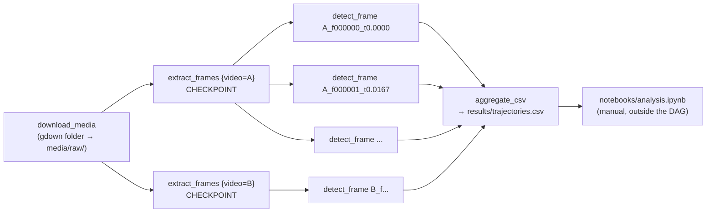

# Workflow plan: video → frames → per-frame detection → CSV

Build a reproducible Snakemake pipeline that turns the pendulum videos into one table, `results/trajectories.csv` (`video_name,t,x,y`). That table is the input for the analysis notebook (amplitude vs. sinusoidal approximation). This plan covers structure and workflow only. The detection method stays a stub that you'll write.

## Decisions from the interview

| Topic | Decision |
|---|---|
| Parallel granularity | **One Snakemake job per frame**, no batching |
| Frame discovery | **Checkpoint**: `extract_frames` writes the frames + a manifest; the DAG is re-evaluated afterwards |
| Video selection | Every video in the Drive folder is listed in `config.yaml`; you comment out the ones to skip |
| Trim | `t_start` / `t_end` in **integer seconds**, `null` = no trim |
| Time in CSV | **Original video time** (no reset to 0) |
| Frame names | `media/frames/{video}/{video}_f{index:06d}_t{seconds:.4f}.png` |
| Per-frame output | `.txt` with the same stem, holding **one CSV row** `video_name,t,x,y` (no header) |
| Background | **One shared image** (e.g. `superfotograma!.png`) for all videos |
| Units | **Pixels**, origin top-left; calibration to meters happens in the notebook |
| Download | **Snakemake rule using `gdown`** |

## Folder layout

```text
labo13-nuevos-videos-1080/
├── Snakefile                    ← includes rules/, top-level `all` target
├── config.yaml                  ← videos, trims, background, paths
├── pyproject.toml               ← package `labo13` (pip install -e .)
├── ruff.toml                    ← tabs, builtins = snakemake
├── workflow/schemas/config.schema.yaml
├── rules/
│   ├── download.smk             ← download_media
│   ├── frames.smk               ← extract_frames (checkpoint)
│   ├── detect.smk               ← detect_frame (1 job/frame)
│   └── aggregate.smk            ← aggregate_csv
├── scripts/                     ← thin adapters (snakemake.input → src)
│   ├── download_media.py
│   ├── extract_frames.py
│   ├── detect_frame.py
│   └── aggregate_csv.py
├── src/labo13/                  ← Colab functions, cleaned (Tier 1)
│   ├── video.py                 ← load/decode/grey/trim/save frames
│   ├── detection.py             ← detect_bob_centroid(frame, background) → (x, y)  [STUB, yours]
│   └── io.py                    ← manifest + row read/write helpers
├── media/                       ← gitignored
│   ├── raw/                     ← Drive folder contents (.MOV + images)
│   └── frames/{video}/          ← grey PNG + TXT per frame
├── results/trajectories.csv     ← final table (gitignored or committed — see Q2)
├── notebooks/analysis.ipynb     ← reads results/trajectories.csv
└── Copia de [LABO 13] ...ipynb  ← original, kept untouched as a reference
```

## DAG



## config.yaml (sketch)

```yaml
drive_folder_url: "https://drive.google.com/drive/folders/10VmY2TRLvBIaaMNBjxqX4qjdgOwvmTSv"
paths:
  raw: media/raw
  frames: media/frames
  output_csv: results/trajectories.csv
background: media/raw/superfotograma!.png   # shared by all videos

videos:            # key = video_name (file stem); comment out to skip
  IMG_1555: {file: IMG_1555.MOV, t_start: null, t_end: null}
  IMG_1556: {file: IMG_1556.MOV, t_start: 2,    t_end: 30}
  # IMG_1569: {file: IMG_1569.MOV, t_start: null, t_end: null}
```

The schema checks that `t_start`/`t_end` are `integer | null`, that `t_start < t_end` when both are set, and that `file` is a string.

## Rules (contract only)

### `download_media`
- **Output:** `media/raw/.done` (sentinel) plus the folder contents.
- **Does:** `gdown --folder <url> -O media/raw`. Needs network, so it runs once; afterwards the sentinel keeps it from re-running.
- **Constraint:** `gdown --folder` stops at 50 files per folder.

### `extract_frames` (checkpoint, per `{video}`)
- **Input:** sentinel, `media/raw/{file}`.
- **Output:** `directory("media/frames/{video}")` + `media/frames/{video}.manifest.tsv` (`index, t, stem`).
- **Does:** decode with PyAV, convert to grey, keep frames with `t_start ≤ t < t_end`, where t is the frame's **real PTS** in seconds (not index/60). Saves each frame as `{video}_f{index:06d}_t{t:.4f}.png`. `index` is the frame index in the original video, so it stays stable when you change the trim.

### `detect_frame` (per `{video}`, `{stem}`)
- **Input:** `media/frames/{video}/{stem}.png`, shared background.
- **Output:** `media/frames/{video}/{stem}.txt`, holding exactly one line: `IMG_1556,12.3456,812.40,503.10`.
- **Does:** `labo13.detection.detect_bob_centroid(frame, background)` → `(x, y)` or `(nan, nan)`. **You implement the method**; the plan only fixes the signature.
- `wildcard_constraints: stem = r"{video}_f\d{6}_t\d+\.\d{4}"`.

### `aggregate_csv`
- **Input:** an input function that reads every checkpoint manifest and lists all `.txt` files.
- **Output:** `results/trajectories.csv` with header `video_name,t,x,y`, sorted by `(video_name, t)`.
- **Does:** concatenate the rows. Fails loudly if a TXT is malformed. Keeps `NaN` rows (never fills them).

## User Review Required

> [!WARNING]
> **Scale of "one job per frame".** ~1800 frames per 30 s video × N videos means tens of thousands of jobs. Each job pays Python start-up plus PyAV/skimage imports (~0.5–1 s), so job overhead can be bigger than the actual work, and Snakemake's DAG/metadata handling slows down at this size. Grey 1080p PNGs are ~0.5–1 MB each, so expect **several GB** in `media/frames/`. This works and was your choice; if it gets painful, Snakemake `group:` jobs are the fallback, and they don't change the file layout.

> [!IMPORTANT]
> Because timestamps are in the filenames, **changing a trim adds or removes frames** but leaves existing frames valid. Re-running only processes the new ones.

## Open Questions

1. **Detection stub:** for now, should `detect_frame` write `NaN,NaN` (pipeline runs end to end), or should I port the notebook's current method (background subtraction → threshold 100–200 → closing disk(2) → largest region centroid) as a starting point you then replace?
2. **Commit `results/trajectories.csv`?** Recommended: yes (small, and the notebook can run without the videos).
3. **Environment:** `uv` + `pyproject.toml` (recommended), or conda `envs/*.yaml` per rule?
4. **Old notebook:** keep it at the root as a reference, or move it to `notebooks/original/`?

## Verification Plan

- `snakemake -n` (dry-run) and `snakemake --lint` are clean.
- Smoke test: enable 1 video with `t_start: 0, t_end: 1` → ~60 PNG + 60 TXT, and a CSV with 60 rows whose `t` matches the filenames.
- Change `t_end` to 2 → only the new ~60 frames get processed.
- `uv run ruff check --fix` / `ruff format` on `src/` and `scripts/`.
- `pytest` for `src/labo13/video.py` trim logic and `io.py` row parsing.
