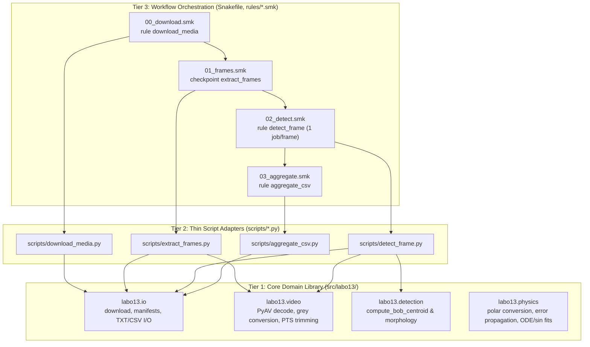

# Extended Workflow Plan (`workflow_plan_bis.md`) — Python + Snakemake Conventions

## Goal Description

Build a reproducible, strictly typed, 3-tier **Python + Snakemake** pipeline in `/home/aaron/bs/labo13-nuevos-videos-1080` that adheres to `python-snakemake-conventions`:

1. **Stage 1 (Snakemake Pipeline — Video $\to$ Greyscale Frames $\to$ Per-Frame Centroid TXT $\to$ `results/trajectories.csv`)**:
   - Download the raw 1080p `.MOV` videos and shared background image from Google Drive (`https://drive.google.com/drive/folders/10VmY2TRLvBIaaMNBjxqX4qjdgOwvmTSv`) into `media/raw/`.
   - Decode each enabled video in `config.yaml`, filter frames by manual integer-second trims (`t_start`, `t_end`, default `null` = untrimmed) using the real container PTS timestamp, convert to 8-bit greyscale, and save each frame as `media/frames/{video}/{video}_f{index:06d}_t{seconds:.4f}.png` via a Snakemake `checkpoint`.
   - Run **one independent Snakemake job per frame** producing `media/frames/{video}/{video}_f{index:06d}_t{seconds:.4f}.txt` containing a single CSV line `video_name,t,x,y` (pixel coordinates, origin top-left, original video timestamp `t`).
   - Aggregate all per-frame `.txt` rows into `results/trajectories.csv` (`video_name,t,x,y`), sorted deterministically by `(video_name, t)`.
2. **Stage 2 (Downstream Analysis Notebook — `notebooks/analysis.ipynb`)**:
   - Consume `results/trajectories.csv` and pure Tier 1 functions from `src/labo13/physics.py` to transform pixel trajectories `(x, y)` into polar angles $\theta(t)$ with propagated statistical and systematic uncertainties, and compare small-angle sinusoidal vs. nonlinear ($\sin\theta$) damped pendulum models across amplitudes.

---

## User Review Required

> [!WARNING]
> **Per-Frame Job Granularity Overhead**: As chosen during the design interview, `detect_frame` executes strictly **one Snakemake job per frame** (~1,800 jobs per 30 s video at 59.96 fps). Each job spawns a Python interpreter and imports `numpy`/`skimage`. If DAG evaluation or process startup becomes a bottleneck on full-length videos, Snakemake `group: "detect"` batching can be enabled later in `rules/02_detect.smk` without altering any filenames, scripts, or Tier 1 functions.

> [!IMPORTANT]
> **Strict Tab Indentation & Linting Gate**: Per `python-snakemake-conventions`, **all** `.py`, `Snakefile`, and `.smk` files must use **tabs (`\t`)** for indentation. Ruff (`uv run ruff check --fix` and `uv run ruff format`) is run exclusively on `.py` files (`Snakefile` and `*.smk` are excluded in `ruff.toml` because Ruff parses standard Python AST).

---

## Open Questions

> [!IMPORTANT]
> Please confirm your preference on these four items before implementation begins:
> 1. **Initial `compute_bob_centroid` body in `src/labo13/detection.py`**:
>    - *(Recommended)* Port the original Colab notebook's background-subtraction + threshold (`100 < diff < 200`) + `skimage.morphology.closing(..., disk(2))` + largest connected-component centroid as a working baseline that you can edit later, **or** leave it as a pure `return ( float("nan"), float("nan") )` stub?
> 2. **Git tracking for `results/trajectories.csv`**:
>    - *(Recommended)* Track `results/trajectories.csv` in Git so `notebooks/analysis.ipynb` runs standalone without re-downloading multi-GB videos, **or** gitignore `results/`?
> 3. **Execution Environment**:
>    - *(Recommended)* Manage dependencies via `uv` + `pyproject.toml` (`.venv` editable install `uv pip install -e ".[dev]"`), **or** also include per-rule `envs/default.yaml` Conda specifications?
> 4. **Original Colab Notebook Location**:
>    - Keep `Copia de [LABO 13] Nuevos Videos 1080.ipynb` at the repository root as committed in `b692f99`, **or** move it under `notebooks/original/`?

---

## 1. Bottom-Up 3-Tier Architecture & Project Layout



### Annotated Directory Tree (`README.md` Standard)

```text
labo13-nuevos-videos-1080/
├── Snakefile                              ← Pipeline orchestration, schema validation & target rules
├── config.yaml                            ← Central parameters, video trim bounds & file paths
├── pyproject.toml                         ← PEP 621 package metadata, dependencies & mypy config
├── ruff.toml                              ← Ruff linter/formatter config (tab indentation, snakemake builtin)
├── .env.example                           ← Template for optional environment variables (never commit .env)
├── .gitignore                             ← Ignores media/, .snakemake/, .venv/, .env, checkpoints
├── README.md                              ← Project overview, ASCII tree, setup & Snakemake commands
├── Copia de [LABO 13] Nuevos Videos 1080.ipynb ← Original unmodified Colab notebook (baseline reference)
├── docs/
│   ├── workflow_plan.md                   ← Initial interview summary plan
│   └── workflow_plan_bis.md               ← Extended convention-compliant implementation plan
├── workflow/
│   └── schemas/
│       └── config.schema.yaml             ← JSON Schema Draft 2020-12 validating config.yaml
├── rules/                                 ← Tier 3: Modular Snakemake rule definitions (*.smk)
│   ├── 00_download.smk                    ← Rule download_media (gdown folder acquisition)
│   ├── 01_frames.smk                      ← Checkpoint extract_frames (grey PNGs + manifest TSV)
│   ├── 02_detect.smk                      ← Rule detect_frame (parallel 1-job-per-frame centroid TXT)
│   └── 03_aggregate.smk                   ← Rule aggregate_csv (checkpoint aggregation into CSV)
├── scripts/                               ← Tier 2: Thin Snakemake adapter scripts (*.py)
│   ├── download_media.py                  ← Unpacks snakemake -> labo13.io.download_drive_folder
│   ├── extract_frames.py                  ← Unpacks snakemake -> labo13.video.extract_trimmed_frames_gray
│   ├── detect_frame.py                    ← Unpacks snakemake -> labo13.detection.compute_bob_centroid
│   └── aggregate_csv.py                   ← Unpacks snakemake -> labo13.io.build_trajectories_dataframe
├── src/                                   ← Tier 1: Pure modular domain library (zero Snakemake coupling)
│   └── labo13/
│       ├── __init__.py                    ← Package exports and version
│       ├── types.py                       ← Dataclasses (FrameRecord, PendulumConstants) & type aliases
│       ├── io.py                          ← Drive download, manifest TSV & per-frame TXT/CSV I/O
│       ├── video.py                       ← PyAV decoding, PTS time trimming & greyscale frame I/O
│       ├── detection.py                   ← Foreground segmentation & centroid extraction
│       └── physics.py                     ← Cartesian-to-polar error propagation, harmonic & ODE fits
├── tests/                                 ← Unit tests independent of Snakemake (pytest)
│   ├── test_io.py                         ← Tests TXT row formatting/parsing & CSV sorting
│   ├── test_video.py                      ← Tests integer-second trim predicates & filename formatting
│   └── test_detection.py                  ← Tests synthetic circle centroid & NaN fallback on empty frame
├── notebooks/
│   └── analysis.ipynb                     ← Stage 2 analysis reading results/trajectories.csv
├── media/                                 ← Gitignored raw media and intermediate frame artifacts
│   ├── raw/                               ← Downloaded .MOV videos and shared background PNG
│   └── frames/
│       └── {video}/                       ← {video}_f{index:06d}_t{seconds:.4f}.{png,txt}
└── results/
    └── trajectories.csv                   ← Final tidy table: video_name,t,x,y
```

---

## 2. Mapping Original Colab Functions to Tier 1 (`src/labo13/`)

All functions in `Copia de [LABO 13] Nuevos Videos 1080.ipynb` are refactored into `src/labo13/` using **action-oriented `snake_case` naming**, **PEP 585/604/526 static typing**, **`numpy.typing` (`npt.NDArray`)**, and **tab indentation**:

| Original Colab Symbol / Cell | Tier 1 Target Module | Action-Oriented Symbol & Signature | Role |
|---|---|---|---|
| Constants `LARGO_PENDULO_*`, `SIGMA_*` (Cell 1, 23) | `labo13.types` | `class PendulumConstants` (frozen dataclass) | Stores physical constants and uncertainties in SI units |
| — | `labo13.types` | `class FrameRecord` (frozen dataclass) | Stores `(video_name: str, frame_index: int, t_sec: float, stem: str, png_path: Path)` |
| `cargar_primer_fotograma` / `cargar_fotograma` (Cells 3, 4, 10) | `labo13.video` | `load_video_frame_gray(video_path: Path, frame_index: int = 0) -> npt.NDArray[np.uint8]` | Decodes a single video frame as a 2D `uint8` greyscale array |
| `Image.open(...).convert('L')` (Cells 11, 18, 22) | `labo13.video` | `load_image_gray(image_path: Path) -> npt.NDArray[np.uint8]` | Reads a PNG/frame image from disk as a 2D `uint8` greyscale array |
| `descargar_fotogramas` / `procesar_video` loop (Cells 9, 18) | `labo13.video` | `extract_trimmed_frames_gray(video_path: Path, video_name: str, output_dir: Path, t_start: int | None = None, t_end: int | None = None) -> list[FrameRecord]` | Streams video via PyAV, filters by `is_within_time_bounds(t_sec, t_start, t_end)`, writes `{video}_f{idx:06d}_t{t:.4f}.png` |
| — | `labo13.video` | `is_within_time_bounds(t_sec: float, t_start: int | None, t_end: int | None) -> bool` | Predicate checking `(t_start is None or t_sec >= t_start) and (t_end is None or t_sec < t_end)` |
| `grafica_fotogramas` (Cell 5) | `labo13.video` | `plot_sampled_frames(video_path: Path, frame_indices: list[int]) -> plt.Figure` | Diagnostic multi-panel plot of selected frames |
| Background subtraction + morphology + `regionprops` (Cells 11–16, 18, 28, 35) | `labo13.detection` | `compute_bob_centroid(frame_gray: npt.NDArray[np.uint8], background_gray: npt.NDArray[np.uint8] | None = None, threshold_low: float = 100.0, threshold_high: float = 200.0, disk_radius: int = 2) -> tuple[float, float]` | Returns `(x_px, y_px)` centroid in image pixel coordinates or `(np.nan, np.nan)` if no region is found |
| — | `labo13.detection` | `_build_foreground_mask(frame_gray: npt.NDArray[np.uint8], background_gray: npt.NDArray[np.uint8], threshold_low: float, threshold_high: float, disk_radius: int) -> npt.NDArray[np.bool_]` | Internal helper performing float subtraction, thresholding, and morphological closing |
| `GravedadCalculada.xy_a_polar` (Cells 28, 35) | `labo13.physics` | `compute_polar_trajectory(df_xy: pd.DataFrame, constants: PendulumConstants, d_real_m: float = 0.0450, d_px: float = 52.0, sigma_d_px: float = 1.0, sigma_x_px: float = 0.5, sigma_y_px: float = 0.5) -> pd.DataFrame` | Converts `(x, y)` pixels to $(X_m, Y_m, R_m, \theta_{\text{rad}}, \sigma_{\theta,\text{stat}}, \sigma_{\theta,\text{total}})$ |
| `GravedadCalculada._ajustar` & `calcular_g` (Cells 28, 35) | `labo13.physics` | `compute_harmonic_fit(df_polar: pd.DataFrame, constants: PendulumConstants, damped: bool = True) -> HarmonicFitResult` | 2-stage weighted `curve_fit` with shutter time-variance propagation and $\chi^2$ |
| `analizar_por_ventanas` (Cell 40) | `labo13.physics` | `compute_sliding_window_periods(df_polar: pd.DataFrame, video_name: str, window_sec: float = 6.0, step_sec: float = 2.0) -> pd.DataFrame` | Evaluates local period $T(\theta_0)$ across decaying amplitude windows |
| `trayectoria`, `ajustar_conjunto`, `comparar_pendulo` (Cell 41) | `labo13.physics` | `compute_ode_trajectory(...)`, `compute_joint_pendulum_fit(...)` | Integrates $\ddot\theta + 2\gamma\dot\theta + \omega_0^2 \sin\theta = 0$ via `solve_ivp(method="DOP853")` and compares linear vs. sine models |

---

## 3. Proposed File Specifications

### Component 1: Project Configuration, Packaging & Quality Tooling

#### [NEW] [pyproject.toml](file:///home/aaron/bs/labo13-nuevos-videos-1080/pyproject.toml)
```toml
[build-system]
requires = ["hatchling"]
build-backend = "hatchling.build"

[project]
name = "labo13"
version = "0.1.0"
description = "Core domain library for LABO 13 pendulum video tracking and nonlinear oscillation analysis"
readme = "README.md"
requires-python = ">=3.10"
dependencies = [
	"av>=12.0",
	"gdown>=5.1",
	"matplotlib>=3.7",
	"numpy>=1.24",
	"pandas>=2.0",
	"pillow>=10.0",
	"scikit-image>=0.22",
	"scipy>=1.10",
	"tqdm>=4.66",
]

[project.optional-dependencies]
dev = [
	"jsonschema>=4.20",
	"mypy>=1.10",
	"pytest>=8.0",
	"ruff>=0.4",
	"snakemake>=8.0",
]

[tool.hatch.build.targets.wheel]
packages = ["src/labo13"]

[tool.mypy]
python_version = "3.12"
strict = true
warn_unused_configs = true
disallow_untyped_defs = true
disallow_incomplete_defs = true
check_untyped_defs = true
no_implicit_optional = true
warn_return_any = true

[[tool.mypy.overrides]]
module = [
	"av.*",
	"gdown.*",
	"matplotlib.*",
	"scipy.*",
	"skimage.*",
	"snakemake.*",
	"tqdm.*",
]
ignore_missing_imports = true
```

#### [NEW] [ruff.toml](file:///home/aaron/bs/labo13-nuevos-videos-1080/ruff.toml)
```toml
builtins = ["snakemake"]
exclude = [
	"scripts/deprecated",
	"media",
	"results",
	".snakemake",
	".venv",
	"Snakefile",
	"*.smk",
	"rules/*.smk",
	"*.ipynb",
]

[format]
indent-style = "tab"
line-ending = "lf"

[lint]
select = [
	"E",   # pycodestyle errors
	"W",   # pycodestyle warnings
	"F",   # pyflakes
	"I",   # isort
	"UP",  # pyupgrade
	"B",   # flake8-bugbear
]
ignore = [
	"W191", # tab indentation in PEP8
	"E111", # indentation not multiple of 4
	"E114", # comment indentation not multiple of 4
	"E117", # over-indented
	"D206", # docstring tab indentation
]

[lint.isort]
lines-after-imports = 2
```

#### [NEW] [config.yaml](file:///home/aaron/bs/labo13-nuevos-videos-1080/config.yaml)
```yaml
paths:
  raw_dir: "media/raw"
  frames_dir: "media/frames"
  background_image: "media/raw/superfotograma!.png"
  trajectories_csv: "results/trajectories.csv"
  logs_dir: "logs"
  benchmarks_dir: "benchmarks"

parameters:
  drive_folder_url: "https://drive.google.com/drive/folders/10VmY2TRLvBIaaMNBjxqX4qjdgOwvmTSv"
  threshold_low: 100.0
  threshold_high: 200.0
  morphology_disk_radius: 2

# All videos from the Google Drive folder.
# Comment out any video entry to exclude it from the pipeline.
# Set t_start / t_end (integer seconds) to trim; null means untrimmed.
videos:
  IMG_1555:
    file: "IMG_1555.MOV"
    t_start: null
    t_end: null
  IMG_1556:
    file: "IMG_1556.MOV"
    t_start: null
    t_end: null
  IMG_1569:
    file: "IMG_1569.MOV"
    t_start: null
    t_end: null
```

#### [NEW] [config.schema.yaml](file:///home/aaron/bs/labo13-nuevos-videos-1080/workflow/schemas/config.schema.yaml)
```yaml
$schema: "https://json-schema.org/draft/2020-12/schema"
title: "Labo13WorkflowConfigSchema"
description: "Validation schema for LABO 13 pendulum tracking pipeline config.yaml"
type: "object"
required:
  - "paths"
  - "parameters"
  - "videos"
additionalProperties: false
properties:
  paths:
    type: "object"
    required:
      - "raw_dir"
      - "frames_dir"
      - "background_image"
      - "trajectories_csv"
      - "logs_dir"
      - "benchmarks_dir"
    additionalProperties: false
    properties:
      raw_dir:
        type: "string"
      frames_dir:
        type: "string"
      background_image:
        type: "string"
      trajectories_csv:
        type: "string"
      logs_dir:
        type: "string"
      benchmarks_dir:
        type: "string"
  parameters:
    type: "object"
    required:
      - "drive_folder_url"
      - "threshold_low"
      - "threshold_high"
      - "morphology_disk_radius"
    additionalProperties: false
    properties:
      drive_folder_url:
        type: "string"
      threshold_low:
        type: "number"
        minimum: 0.0
        maximum: 255.0
      threshold_high:
        type: "number"
        minimum: 0.0
        maximum: 255.0
      morphology_disk_radius:
        type: "integer"
        minimum: 1
  videos:
    type: "object"
    minProperties: 1
    additionalProperties:
      type: "object"
      required:
        - "file"
        - "t_start"
        - "t_end"
      additionalProperties: false
      properties:
        file:
          type: "string"
        t_start:
          type: ["integer", "null"]
          minimum: 0
        t_end:
          type: ["integer", "null"]
          minimum: 1
```

#### [NEW] [.env.example](file:///home/aaron/bs/labo13-nuevos-videos-1080/.env.example) & [MODIFY] [.gitignore](file:///home/aaron/bs/labo13-nuevos-videos-1080/.gitignore)
- `.env.example`: Documents optional environment variables (e.g., `GDRIVE_API_KEY=` if ever needed).
- `.gitignore`: Ignore `media/`, `.snakemake/`, `.venv/`, `logs/`, `benchmarks/`, `.env`, `*.secret`, `.ruff_cache/`, `.mypy_cache/`, `.pytest_cache/`, `*.egg-info/`.

---

### Component 2: Tier 1 Core Domain Library (`src/labo13/`)

#### [NEW] [types.py](file:///home/aaron/bs/labo13-nuevos-videos-1080/src/labo13/types.py)
```python
from dataclasses import dataclass
from pathlib import Path


type VideoName = str
type PixelCentroid = tuple[float, float]


@dataclass(frozen=True)
class FrameRecord:
	video_name: VideoName
	frame_index: int
	t_sec: float
	stem: str
	png_path: Path


@dataclass(frozen=True)
class PendulumConstants:
	length_no_base_m: float = 0.737
	length_with_base_m: float = 0.778
	sigma_length_m: float = 0.005
	width_m: float = 0.003
	sigma_caliper_m: float = 0.0002
	sigma_frame_s: float = 1.0 / 59.96
```

#### [NEW] [io.py](file:///home/aaron/bs/labo13-nuevos-videos-1080/src/labo13/io.py)
```python
from pathlib import Path

import gdown
import pandas as pd

from labo13.types import FrameRecord


def download_drive_folder(folder_url: str, output_dir: Path) -> list[Path]:
	"""Download all files from a public Google Drive folder into output_dir."""
	output_dir.mkdir(parents=True, exist_ok=True)
	downloaded_files: list[str] | None = gdown.download_folder(
		url=folder_url,
		output=str(output_dir),
		quiet=False,
		use_cookies=False,
	)
	if not downloaded_files:
		raise RuntimeError(f"Failed to download Google Drive folder: {folder_url}")
	paths: list[Path] = [Path(p) for p in downloaded_files]
	return paths


def save_frame_manifest(records: list[FrameRecord], manifest_path: Path) -> None:
	"""Write frame metadata records to a TSV manifest file."""
	manifest_path.parent.mkdir(parents=True, exist_ok=True)
	rows: list[dict[str, str | int | float]] = [
		{
			"video_name": rec.video_name,
			"frame_index": rec.frame_index,
			"t_sec": f"{rec.t_sec:.4f}",
			"stem": rec.stem,
			"png_path": str(rec.png_path),
		}
		for rec in records
	]
	df_manifest: pd.DataFrame = pd.DataFrame(
		rows, columns=["video_name", "frame_index", "t_sec", "stem", "png_path"]
	)
	df_manifest.to_csv(manifest_path, sep="\t", index=False)


def load_frame_manifest(manifest_path: Path) -> pd.DataFrame:
	"""Read a per-video frame manifest TSV."""
	df_manifest: pd.DataFrame = pd.read_csv(
		manifest_path,
		sep="\t",
		dtype={"video_name": str, "frame_index": int, "t_sec": float, "stem": str, "png_path": str},
	)
	return df_manifest


def parse_stem_metadata(stem: str) -> tuple[str, int, float]:
	"""Extract (video_name, frame_index, t_sec) from '{video}_f{index:06d}_t{seconds:.4f}'."""
	prefix_part: str
	t_part: str
	prefix_part, t_part = stem.rsplit("_t", maxsplit=1)
	video_name: str
	idx_part: str
	video_name, idx_part = prefix_part.rsplit("_f", maxsplit=1)
	frame_index: int = int(idx_part)
	t_sec: float = float(t_part)
	return video_name, frame_index, t_sec


def save_frame_detection_row(
	video_name: str,
	t_sec: float,
	x_px: float,
	y_px: float,
	output_txt: Path,
) -> None:
	"""Save a single CSV row 'video_name,t,x,y' (no header) to a per-frame .txt file."""
	output_txt.parent.mkdir(parents=True, exist_ok=True)
	line: str = f"{video_name},{t_sec:.4f},{x_px:.6f},{y_px:.6f}\n"
	output_txt.write_text(line, encoding="utf-8")


def load_frame_detection_row(input_txt: Path) -> dict[str, str | float]:
	"""Parse a single per-frame .txt file into a record dictionary."""
	raw_line: str = input_txt.read_text(encoding="utf-8").strip()
	parts: list[str] = raw_line.split(",")
	if len(parts) != 4:
		raise ValueError(f"Malformed detection row in {input_txt}: {raw_line!r}")
	record: dict[str, str | float] = {
		"video_name": parts[0],
		"t": float(parts[1]),
		"x": float(parts[2]),
		"y": float(parts[3]),
	}
	return record


def build_trajectories_dataframe(txt_paths: list[Path]) -> pd.DataFrame:
	"""Aggregate all per-frame .txt files into a sorted DataFrame (video_name, t, x, y)."""
	records: list[dict[str, str | float]] = [
		load_frame_detection_row(path) for path in txt_paths
	]
	df_traj: pd.DataFrame = pd.DataFrame(records, columns=["video_name", "t", "x", "y"])
	df_sorted: pd.DataFrame = df_traj.sort_values(
		by=["video_name", "t"], ascending=[True, True], kind="mergesort"
	).reset_index(drop=True)
	return df_sorted


def export_trajectories_csv(df_traj: pd.DataFrame, output_csv: Path) -> None:
	"""Write the aggregated trajectories DataFrame to disk."""
	output_csv.parent.mkdir(parents=True, exist_ok=True)
	df_traj.to_csv(output_csv, index=False, float_format="%.6f")
```

#### [NEW] [video.py](file:///home/aaron/bs/labo13-nuevos-videos-1080/src/labo13/video.py)
```python
from pathlib import Path

import av
import numpy as np
import numpy.typing as npt
from PIL import Image

from labo13.types import FrameRecord


def is_within_time_bounds(
	t_sec: float,
	t_start: int | None,
	t_end: int | None,
) -> bool:
	"""Return True if t_sec falls within [t_start, t_end) where None means unbounded."""
	if t_start is not None and t_sec < float(t_start):
		return False
	if t_end is not None and t_sec >= float(t_end):
		return False
	return True


def format_frame_stem(video_name: str, frame_index: int, t_sec: float) -> str:
	"""Format illustrative frame stem '{video}_f{index:06d}_t{seconds:.4f}'."""
	stem: str = f"{video_name}_f{frame_index:06d}_t{t_sec:.4f}"
	return stem


def load_image_gray(image_path: Path) -> npt.NDArray[np.uint8]:
	"""Load an image file from disk as a 2D uint8 greyscale array."""
	with Image.open(image_path) as img:
		gray_img: Image.Image = img.convert("L")
		arr: npt.NDArray[np.uint8] = np.asarray(gray_img, dtype=np.uint8)
	return arr


def save_image_gray(frame_gray: npt.NDArray[np.uint8], output_path: Path) -> None:
	"""Save a 2D uint8 greyscale array as a lossless PNG."""
	output_path.parent.mkdir(parents=True, exist_ok=True)
	Image.fromarray(frame_gray, mode="L").save(output_path, format="PNG")


def extract_trimmed_frames_gray(
	video_path: Path,
	video_name: str,
	output_dir: Path,
	t_start: int | None = None,
	t_end: int | None = None,
) -> list[FrameRecord]:
	"""Decode video to greyscale PNG frames within [t_start, t_end) keeping original video time."""
	if t_start is not None and t_end is not None and t_start >= t_end:
		raise ValueError(f"Invalid trim bounds for {video_name}: t_start={t_start} >= t_end={t_end}")

	output_dir.mkdir(parents=True, exist_ok=True)
	records: list[FrameRecord] = []

	with av.open(str(video_path)) as container:
		stream = container.streams.video[0]
		fps: float = float(stream.average_rate) if stream.average_rate is not None else 59.96

		for idx, frame in enumerate(container.decode(video=0)):
			t_sec: float = float(frame.time) if frame.time is not None else float(idx) / fps
			if t_end is not None and t_sec >= float(t_end):
				break
			if not is_within_time_bounds(t_sec=t_sec, t_start=t_start, t_end=t_end):
				continue

			frame_gray: npt.NDArray[np.uint8] = frame.to_ndarray(format="gray")
			stem: str = format_frame_stem(video_name=video_name, frame_index=idx, t_sec=t_sec)
			png_path: Path = output_dir / f"{stem}.png"
			save_image_gray(frame_gray=frame_gray, output_path=png_path)
			records.append(
				FrameRecord(
					video_name=video_name,
					frame_index=idx,
					t_sec=t_sec,
					stem=stem,
					png_path=png_path,
				)
			)

	return records
```

#### [NEW] [detection.py](file:///home/aaron/bs/labo13-nuevos-videos-1080/src/labo13/detection.py)
```python
import numpy as np
import numpy.typing as npt
import skimage.measure
import skimage.morphology

from labo13.types import PixelCentroid


def _build_foreground_mask(
	frame_gray: npt.NDArray[np.uint8],
	background_gray: npt.NDArray[np.uint8],
	threshold_low: float,
	threshold_high: float,
	disk_radius: int,
) -> npt.NDArray[np.bool_]:
	"""Subtract background, threshold intensity difference, and apply morphological closing."""
	diff_image: npt.NDArray[np.float64] = background_gray.astype(np.float64) - frame_gray.astype(
		np.float64
	)
	raw_mask: npt.NDArray[np.bool_] = (diff_image > threshold_low) & (diff_image < threshold_high)
	footprint: npt.NDArray[np.uint8] = skimage.morphology.disk(disk_radius)
	closed_mask: npt.NDArray[np.bool_] = skimage.morphology.closing(raw_mask, footprint)
	return closed_mask


def compute_bob_centroid(
	frame_gray: npt.NDArray[np.uint8],
	background_gray: npt.NDArray[np.uint8],
	threshold_low: float = 100.0,
	threshold_high: float = 200.0,
	disk_radius: int = 2,
) -> PixelCentroid:
	"""Compute bob centroid (x_px, y_px) in image coordinates (origin top-left) or (nan, nan)."""
	mask: npt.NDArray[np.bool_] = _build_foreground_mask(
		frame_gray=frame_gray,
		background_gray=background_gray,
		threshold_low=threshold_low,
		threshold_high=threshold_high,
		disk_radius=disk_radius,
	)
	labels: npt.NDArray[np.int64] = skimage.measure.label(mask)
	regions: list[skimage.measure._regionprops.RegionProperties] = skimage.measure.regionprops(
		labels
	)
	if not regions:
		return (float("nan"), float("nan"))

	largest_region = max(regions, key=lambda r: float(r.area))
	y_center: float
	x_center: float
	y_center, x_center = largest_region.centroid
	return (float(x_center), float(y_center))
```

---

### Component 3: Tier 2 Script Adapters (`scripts/*.py`)

Every script in `scripts/` is a thin adapter that:
1. Declares the `TYPE_CHECKING` Snakemake stub.
2. Configures file logging to `snakemake.log[0]`.
3. Unpacks named `snakemake.input`, `snakemake.output`, and `snakemake.params`.
4. Calls pure Tier 1 functions in `labo13`.

#### [NEW] [detect_frame.py](file:///home/aaron/bs/labo13-nuevos-videos-1080/scripts/detect_frame.py) (Representative Adapter)
```python
from pathlib import Path
from typing import TYPE_CHECKING

import numpy as np
import numpy.typing as npt

from labo13.detection import compute_bob_centroid
from labo13.io import parse_stem_metadata, save_frame_detection_row
from labo13.video import load_image_gray


if TYPE_CHECKING:
	from snakemake.script import Snakemake

	snakemake: Snakemake


def main() -> None:
	frame_path: Path = Path(snakemake.input.frame_png)
	background_path: Path = Path(snakemake.input.background_png)
	output_txt: Path = Path(snakemake.output.row_txt)

	threshold_low: float = float(snakemake.params.threshold_low)
	threshold_high: float = float(snakemake.params.threshold_high)
	disk_radius: int = int(snakemake.params.disk_radius)

	video_name: str
	_frame_index: int
	t_sec: float
	video_name, _frame_index, t_sec = parse_stem_metadata(frame_path.stem)

	frame_gray: npt.NDArray[np.uint8] = load_image_gray(frame_path)
	background_gray: npt.NDArray[np.uint8] = load_image_gray(background_path)

	x_px: float
	y_px: float
	x_px, y_px = compute_bob_centroid(
		frame_gray=frame_gray,
		background_gray=background_gray,
		threshold_low=threshold_low,
		threshold_high=threshold_high,
		disk_radius=disk_radius,
	)

	save_frame_detection_row(
		video_name=video_name,
		t_sec=t_sec,
		x_px=x_px,
		y_px=y_px,
		output_txt=output_txt,
	)


if __name__ == "__main__":
	main()
```

---

### Component 4: Tier 3 Workflow Orchestration (`Snakefile` & `rules/*.smk`)

All rules strictly obey the **Canonical Rule Directive Ordering** (`python-snakemake-conventions` §3.A):
`docstring` $\to$ `wildcard_constraints` $\to$ `input` $\to$ `output` $\to$ `log` $\to$ `benchmark` $\to$ `params` $\to$ `threads` $\to$ `resources` $\to$ `script`.

#### [NEW] [Snakefile](file:///home/aaron/bs/labo13-nuevos-videos-1080/Snakefile)
```snakemake
from snakemake.utils import validate


configfile: "config.yaml"


validate(config, schema="workflow/schemas/config.schema.yaml")

VIDEOS: list[str] = list(config["videos"].keys())
VIDEO_REGEX: str = "|".join(VIDEOS)


include: "rules/00_download.smk"
include: "rules/01_frames.smk"
include: "rules/02_detect.smk"
include: "rules/03_aggregate.smk"


rule all:
	'''Build the unified pendulum trajectories CSV across all enabled videos.'''
	input:
		trajectories_csv = config["paths"]["trajectories_csv"]
```

#### [NEW] [00_download.smk](file:///home/aaron/bs/labo13-nuevos-videos-1080/rules/00_download.smk)
```snakemake
rule download_media:
	'''Download raw pendulum videos and shared background image from Google Drive.'''
	output:
		sentinel = touch(f"{config['paths']['raw_dir']}/.download_complete"),
		background_png = config["paths"]["background_image"]
	log:
		f"{config['paths']['logs_dir']}/download_media.log"
	benchmark:
		f"{config['paths']['benchmarks_dir']}/download_media.tsv"
	params:
		drive_folder_url = config["parameters"]["drive_folder_url"],
		raw_dir = config["paths"]["raw_dir"]
	threads: 1
	resources:
		mem_mb = 1000
	script:
		"../scripts/download_media.py"
```

#### [NEW] [01_frames.smk](file:///home/aaron/bs/labo13-nuevos-videos-1080/rules/01_frames.smk)
```snakemake
checkpoint extract_frames:
	'''Convert a video to greyscale PNG frames within configured [t_start, t_end) bounds.'''
	wildcard_constraints:
		video = VIDEO_REGEX
	input:
		download_sentinel = f"{config['paths']['raw_dir']}/.download_complete"
	output:
		frames_dir = directory(f"{config['paths']['frames_dir']}/{{video}}"),
		manifest_tsv = f"{config['paths']['frames_dir']}/{{video}}.manifest.tsv"
	log:
		f"{config['paths']['logs_dir']}/extract_frames/{{video}}.log"
	benchmark:
		f"{config['paths']['benchmarks_dir']}/extract_frames/{{video}}.tsv"
	params:
		video_file = lambda wildcards: f"{config['paths']['raw_dir']}/{config['videos'][wildcards.video]['file']}",
		t_start = lambda wildcards: config["videos"][wildcards.video]["t_start"],
		t_end = lambda wildcards: config["videos"][wildcards.video]["t_end"]
	threads: 1
	resources:
		mem_mb = 2000
	script:
		"../scripts/extract_frames.py"
```

#### [NEW] [02_detect.smk](file:///home/aaron/bs/labo13-nuevos-videos-1080/rules/02_detect.smk)
```snakemake
rule detect_frame:
	'''Detect pendulum bob centroid for a single greyscale frame and write one CSV row to .txt.'''
	wildcard_constraints:
		video = VIDEO_REGEX,
		stem = r".+_f\d{6}_t\d+\.\d{4}"
	input:
		frame_png = f"{config['paths']['frames_dir']}/{{video}}/{{stem}}.png",
		background_png = config["paths"]["background_image"]
	output:
		row_txt = f"{config['paths']['frames_dir']}/{{video}}/{{stem}}.txt"
	log:
		f"{config['paths']['logs_dir']}/detect_frame/{{video}}/{{stem}}.log"
	benchmark:
		f"{config['paths']['benchmarks_dir']}/detect_frame/{{video}}/{{stem}}.tsv"
	params:
		threshold_low = config["parameters"]["threshold_low"],
		threshold_high = config["parameters"]["threshold_high"],
		disk_radius = config["parameters"]["morphology_disk_radius"]
	threads: 1
	resources:
		mem_mb = 500
	script:
		"../scripts/detect_frame.py"
```

#### [NEW] [03_aggregate.smk](file:///home/aaron/bs/labo13-nuevos-videos-1080/rules/03_aggregate.smk)
```snakemake
from pathlib import Path
import pandas as pd


def collect_detected_frame_txts(wildcards) -> list[str]:
	'''Resolve checkpoint manifests to list all expected per-frame .txt files across active videos.'''
	txt_files: list[str] = []
	frames_root: str = config["paths"]["frames_dir"]
	for video in VIDEOS:
		ckpt_output = checkpoints.extract_frames.get(video=video).output
		manifest_path: Path = Path(ckpt_output.manifest_tsv)
		df_manifest: pd.DataFrame = pd.read_csv(manifest_path, sep="\t")
		for stem in df_manifest["stem"].astype(str):
			txt_files.append(f"{frames_root}/{video}/{stem}.txt")
	return txt_files


rule aggregate_csv:
	'''Concatenate all per-frame .txt detection rows into results/trajectories.csv.'''
	input:
		frame_txts = collect_detected_frame_txts
	output:
		trajectories_csv = config["paths"]["trajectories_csv"]
	log:
		f"{config['paths']['logs_dir']}/aggregate_csv.log"
	benchmark:
		f"{config['paths']['benchmarks_dir']}/aggregate_csv.tsv"
	threads: 1
	resources:
		mem_mb = 1000
	script:
		"../scripts/aggregate_csv.py"
```

---

## 4. Scoped Conventional Commit Sequence (`python-snakemake-conventions` §6)

Once the plan is approved and implemented, changes will be staged and committed in strict bottom-up scope order:

1. **`chore(deps)`**: `pyproject.toml`, `ruff.toml`, `.gitignore`, `.env.example`
2. **`config(config)`**: `config.yaml`, `workflow/schemas/config.schema.yaml`
3. **`feat(src)`**: `src/labo13/{__init__,types,io,video,detection,physics}.py` + `tests/test_*.py`
4. **`feat(scripts)`**: `scripts/{download_media,extract_frames,detect_frame,aggregate_csv}.py`
5. **`feat(rules)`**: `Snakefile`, `rules/{00_download,01_frames,02_detect,03_aggregate}.smk`
6. **`docs(readme)`**: `README.md` updated with annotated ASCII tree, 3-line library quick-start, and Snakemake CLI commands

---

## Verification Plan

### Automated Quality & Linting Gates
```bash
# 1. Editable installation of Tier 1 library + dev tools
uv pip install -e ".[dev]"

# 2. Ruff lint-fix and tab-formatting on all Python files
uv run ruff check --fix src/ scripts/ tests/
uv run ruff format src/ scripts/ tests/

# 3. Strict static type checking (PEP 585/604/526 + numpy.typing)
uv run mypy src/ scripts/ tests/

# 4. Tier 1 unit tests (independent of Snakemake)
uv run pytest -v

# 5. Snakemake DSL semantic lint & dry-run DAG validation
uv run snakemake --lint
uv run snakemake -n
```

### End-to-End Smoke Verification
1. Set `t_start: 0` and `t_end: 1` for a single enabled video in `config.yaml`.
2. Run `uv run snakemake --cores all`.
3. Verify:
   - `media/frames/{video}/` contains ~60 greyscale `.png` and `.txt` files matching `{video}_f{index:06d}_t{seconds:.4f}.{png,txt}`.
   - `results/trajectories.csv` has header `video_name,t,x,y` and ~60 sorted rows with original video timestamps.
4. Update `t_end: 2` and run `uv run snakemake -n`: verify Snakemake schedules `detect_frame` **only** for the newly added frames (`1 <= t < 2`).
