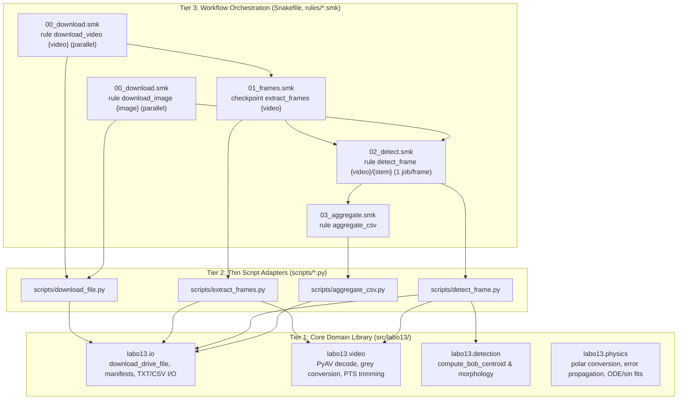

# Extended Workflow Plan (`workflow_plan_bis.md`) — Python + Snakemake Conventions

## Goal Description

Build a reproducible, strictly typed, 3-tier **Python + Snakemake** pipeline in `/home/aaron/bs/labo13-nuevos-videos-1080` that adheres to `python-snakemake-conventions`:

1. **Stage 1 (Snakemake Pipeline — Parallel File Download $\to$ Greyscale Frames $\to$ Per-Frame Centroid TXT $\to$ `results/trajectories.csv`)**:
   - Download the 15 active 1080p oscillation `.MOV` videos (`IMG_1555.MOV`–`IMG_1569.MOV`; `IMG_1570.MOV` is measurement evidence and excluded) and the shared background image (`superfotograma.png`) **in parallel** (one Snakemake job per file) directly from their individual Google Drive URLs configured in `config.yaml`.
   - Decode each enabled video in `config.yaml`, filter frames by manual integer-second trims (`t_start`, `t_end`, default `null` = untrimmed) using the real container PTS timestamp, convert to 8-bit greyscale, and save each frame as `media/frames/{video}/{video}_f{index:06d}_t{seconds:.4f}.png` via a Snakemake `checkpoint`.
   - Run **one independent Snakemake job per frame** producing `media/frames/{video}/{video}_f{index:06d}_t{seconds:.4f}.txt` containing a single CSV line `video_name,t,x,y` (pixel coordinates, origin top-left, original video timestamp `t`).
   - Aggregate all per-frame `.txt` rows into `results/trajectories.csv` (`video_name,t,x,y`), sorted deterministically by `(video_name, t)`.
2. **Stage 2 (Downstream Analysis Notebook — `notebooks/analysis.ipynb`)**:
   - Consume `results/trajectories.csv` and pure Tier 1 functions from `src/labo13/physics.py` to transform pixel trajectories `(x, y)` into polar angles $\theta(t)$ with propagated statistical and systematic uncertainties, and compare small-angle sinusoidal vs. nonlinear ($\sin\theta$) damped pendulum models across amplitudes.

---

## Extracted Google Drive Files Inventory (22 Links)

### Videos (16 `.MOV` Files — 15 Active, 1 Measurement Evidence)

| Config Key | Original Drive Filename | Local Path (`media/raw/videos/`) | Status / Role | Google Drive URL |
|---|---|---|---|---|
| `IMG_1555` | `Copia de IMG_1555.MOV` | `media/raw/videos/IMG_1555.MOV` | Active — pendulum oscillation video | https://drive.google.com/file/d/1yiYkiyyFnH82KI7UQBh_dGtKFII0p76R/view?usp=drive_link |
| `IMG_1556` | `Copia de IMG_1556.MOV` | `media/raw/videos/IMG_1556.MOV` | Active — pendulum oscillation video | https://drive.google.com/file/d/1Ko_iG_jW-eF3aX8xf-cvqhTFmNtceOSE/view?usp=drive_link |
| `IMG_1557` | `Copia de IMG_1557.MOV` | `media/raw/videos/IMG_1557.MOV` | Active — pendulum oscillation video | https://drive.google.com/file/d/1sPhB7ZXdDpAlu3-gkL8NMXjqvmiCZ4vf/view?usp=drive_link |
| `IMG_1558` | `Copia de IMG_1558.MOV` | `media/raw/videos/IMG_1558.MOV` | Active — pendulum oscillation video | https://drive.google.com/file/d/11EvlSCqtED3f4dqSZ3tcjMYAoBBoI3_D/view?usp=drive_link |
| `IMG_1559` | `Copia de IMG_1559.MOV` | `media/raw/videos/IMG_1559.MOV` | Active — pendulum oscillation video | https://drive.google.com/file/d/1fAx-53cf7GMUyZbGZRhvdtlIEtoU0MX4/view?usp=drive_link |
| `IMG_1560` | `Copia de IMG_1560.MOV` | `media/raw/videos/IMG_1560.MOV` | Active — pendulum oscillation video | https://drive.google.com/file/d/1RynR6hOrd2CehShZ23yNl4LZ0phhWTTo/view?usp=drive_link |
| `IMG_1561` | `Copia de IMG_1561.MOV` | `media/raw/videos/IMG_1561.MOV` | Active — pendulum oscillation video | https://drive.google.com/file/d/1dUE8vjWjRxv9dS6A6IIJm2_VQwXDBmzP/view?usp=drive_link |
| `IMG_1562` | `Copia de IMG_1562.MOV` | `media/raw/videos/IMG_1562.MOV` | Active — pendulum oscillation video | https://drive.google.com/file/d/1FGHw9uC1k9yuTHkOqSoexXQxKgg9-xKz/view?usp=drive_link |
| `IMG_1563` | `Copia de IMG_1563.MOV` | `media/raw/videos/IMG_1563.MOV` | Active — pendulum oscillation video | https://drive.google.com/file/d/1iFds9fidJmm_7bCraIAWWR6LcJsTDSc0/view?usp=drive_link |
| `IMG_1564` | `Copia de IMG_1564.MOV` | `media/raw/videos/IMG_1564.MOV` | Active — pendulum oscillation video | https://drive.google.com/file/d/16hDMUF1zdKZSXkKT8pUPPzrGAWTtnlkb/view?usp=drive_link |
| `IMG_1565` | `Copia de IMG_1565.MOV` | `media/raw/videos/IMG_1565.MOV` | Active — pendulum oscillation video | https://drive.google.com/file/d/16ndBa5GYvaGHjuu1711Ct7iMMoeEpUfh/view?usp=drive_link |
| `IMG_1566` | `Copia de IMG_1566.MOV` | `media/raw/videos/IMG_1566.MOV` | Active — pendulum oscillation video | https://drive.google.com/file/d/1BJGQhoKvkviezTdvhw1LzXdSv-LoENst/view?usp=drive_link |
| `IMG_1567` | `Copia de IMG_1567.MOV` | `media/raw/videos/IMG_1567.MOV` | Active — pendulum oscillation video | https://drive.google.com/file/d/1y5dY7WYAW8NgpqkZEfVx2DWa6bo5JgIR/view?usp=drive_link |
| `IMG_1568` | `Copia de IMG_1568.MOV` | `media/raw/videos/IMG_1568.MOV` | Active — pendulum oscillation video | https://drive.google.com/file/d/1VUcrtZoA1mz7IaMXoH2-2WqOhUlgAti9/view?usp=drive_link |
| `IMG_1569` | `Copia de IMG_1569.MOV` | `media/raw/videos/IMG_1569.MOV` | Active — pendulum oscillation video | https://drive.google.com/file/d/1eZCqKr-aIibRBEc1iHHBiQ_NOTzZPzUj/view?usp=drive_link |
| `IMG_1570` | `Copia de IMG_1570.MOV` | `media/raw/videos/IMG_1570.MOV` | Excluded (commented in `config.yaml`) — measurement evidence only | https://drive.google.com/file/d/1z8ZBpSmhMwIGJEqK9fN1YptAB8TFiFXs/view?usp=drive_link |

### Images (6 `.png` / `.jpg` Files — Only `superfotograma` Active)

| Config Key | Original Drive Filename | Local Path (`media/raw/images/`) | Status / Role | Google Drive URL |
|---|---|---|---|---|
| `superfotograma` | `Copia de superfotograma!.png` | `media/raw/images/superfotograma.png` | Active — shared background image for subtraction | https://drive.google.com/file/d/1ShYsEFDkAN1E-0kqmVTgIDS4sPruT6MI/view?usp=drive_link |
| `fotograma_1` | `Copia de fotograma_1.png` | `media/raw/images/fotograma_1.png` | Excluded (commented in `config.yaml`) — unused single-frame snapshot | https://drive.google.com/file/d/19to2iFrK9P6G07SkrLwqDtP1ynoblTEo/view?usp=drive_link |
| `fotograma_100` | `Copia de fotograma_100.png` | `media/raw/images/fotograma_100.png` | Excluded (commented in `config.yaml`) — unused single-frame snapshot | https://drive.google.com/file/d/1cmgbnIxMP79ELj2D2KjGHmud2Cm2hPXd/view?usp=drive_link |
| `fotograma_200` | `Copia de fotograma_200.png` | `media/raw/images/fotograma_200.png` | Excluded (commented in `config.yaml`) — unused single-frame snapshot | https://drive.google.com/file/d/1kbLIR8_TYcDvm7I5CpWnNd1bFPHzOj7k/view?usp=drive_link |
| `primer_fotograma_1` | `Copia de primer_fotograma.jpg` | `media/raw/images/primer_fotograma_1.jpg` | Excluded (commented in `config.yaml`) — unused single-frame snapshot | https://drive.google.com/file/d/16lbQAkDNkBsz2YlzmPsu6qO7hV5b7YhL/view?usp=drive_link |
| `primer_fotograma_2` | `Copia de primer_fotograma.jpg` | `media/raw/images/primer_fotograma_2.jpg` | Excluded (commented in `config.yaml`) — unused single-frame snapshot | https://drive.google.com/file/d/1lR-8Q0hvlughHIaEoo5EjQnkANZT3nHN/view?usp=drive_link |

> [!NOTE]
> The Drive folder contains two distinct files both named `Copia de primer_fotograma.jpg` (`16lbQAk...` and `1lR-8Q0...`). In `config.yaml` they are disambiguated as `primer_fotograma_1` and `primer_fotograma_2` so neither overwrites the other during parallel download.

---

## User Review Required

> [!WARNING]
> **Per-Frame Job Granularity Overhead**: As chosen during the design interview, `detect_frame` executes strictly **one Snakemake job per frame** (~1,800 jobs per 30 s video at 59.96 fps). Across 16 videos, that can reach ~25,000+ jobs. Commenting out unused videos in `config.yaml` skips both downloading and frame extraction for those videos.

> [!IMPORTANT]
> **Strict Tab Indentation & Linting Gate**: Per `python-snakemake-conventions`, **all** `.py`, `Snakefile`, and `.smk` files must use **tabs (`\t`)** for indentation. Ruff (`uv run ruff check --fix` and `uv run ruff format`) is run exclusively on `.py` files (`Snakefile` and `*.smk` are excluded in `ruff.toml` because Ruff parses standard Python AST).

---

## Resolved Design Decisions

| Decision Area | Final Choice |
|---|---|
| **Detection algorithm & parameters** | Port Colab method (`background - frame`, `threshold_low < diff < threshold_high`, `closing(disk(morphology_disk_radius))`, largest region centroid) parameterized in `config.yaml` with Colab defaults (`threshold_low: 100.0`, `threshold_high: 200.0`, `morphology_disk_radius: 2`). |
| **Git tracking of `results/trajectories.csv`** | **Tracked in Git** so `notebooks/analysis.ipynb` runs standalone without downloading raw videos. |
| **Execution environment** | **`uv` + `pyproject.toml`** (`.venv` editable install `uv pip install -e ".[dev]"`). |
| **Original Colab notebook path** | Moved via `git mv` to `notebooks/original/Copia de [LABO 13] Nuevos Videos 1080.ipynb`. |
| **`IMG_1570.MOV` & snapshot images** | `IMG_1570.MOV` (measurement evidence) and the 5 single-frame snapshot images are commented out in `config.yaml`; only `IMG_1555`–`IMG_1569` and `superfotograma` are active. |

---

## 1. Bottom-Up 3-Tier Architecture & Project Layout



### Annotated Directory Tree (`README.md` Standard)

```text
labo13-nuevos-videos-1080/
├── Snakefile                              ← Pipeline orchestration, schema validation & target rules
├── config.yaml                            ← Central parameters, per-file Drive URLs & video trim bounds
├── pyproject.toml                         ← PEP 621 package metadata, dependencies & mypy config
├── ruff.toml                              ← Ruff linter/formatter config (tab indentation, snakemake builtin)
├── .env.example                           ← Template for optional environment variables (never commit .env)
├── .gitignore                             ← Ignores media/, .snakemake/, .venv/, .env, checkpoints
├── README.md                              ← Project overview, ASCII tree, setup & Snakemake commands
├── docs/
│   ├── workflow_plan.md                   ← Initial interview summary plan
│   └── workflow_plan_bis.md               ← Extended convention-compliant implementation plan
├── workflow/
│   └── schemas/
│       └── config.schema.yaml             ← JSON Schema Draft 2020-12 validating config.yaml
├── rules/                                 ← Tier 3: Modular Snakemake rule definitions (*.smk)
│   ├── 00_download.smk                    ← Parallel rules download_video & download_image (gdown)
│   ├── 01_frames.smk                      ← Checkpoint extract_frames (grey PNGs + manifest TSV)
│   ├── 02_detect.smk                      ← Rule detect_frame (parallel 1-job-per-frame centroid TXT)
│   └── 03_aggregate.smk                   ← Rule aggregate_csv (checkpoint aggregation into CSV)
├── scripts/                               ← Tier 2: Thin Snakemake adapter scripts (*.py)
│   ├── download_file.py                   ← Unpacks snakemake -> labo13.io.download_drive_file
│   ├── extract_frames.py                  ← Unpacks snakemake -> labo13.video.extract_trimmed_frames_gray
│   ├── detect_frame.py                    ← Unpacks snakemake -> labo13.detection.compute_bob_centroid
│   └── aggregate_csv.py                   ← Unpacks snakemake -> labo13.io.build_trajectories_dataframe
├── src/                                   ← Tier 1: Pure modular domain library (zero Snakemake coupling)
│   └── labo13/
│       ├── __init__.py                    ← Package exports and version
│       ├── types.py                       ← Dataclasses (FrameRecord, PendulumConstants) & type aliases
│       ├── io.py                          ← Per-file Drive download, manifest TSV & TXT/CSV I/O
│       ├── video.py                       ← PyAV decoding, PTS time trimming & greyscale frame I/O
│       ├── detection.py                   ← Foreground segmentation & centroid extraction
│       └── physics.py                     ← Cartesian-to-polar error propagation, harmonic & ODE fits
├── tests/                                 ← Unit tests independent of Snakemake (pytest)
│   ├── test_io.py                         ← Tests TXT row formatting/parsing & CSV sorting
│   ├── test_video.py                      ← Tests integer-second trim predicates & filename formatting
│   └── test_detection.py                  ← Tests synthetic circle centroid & NaN fallback on empty frame
├── notebooks/
│   ├── original/
│   │   └── Copia de [LABO 13] Nuevos Videos 1080.ipynb ← Original unmodified Colab notebook
│   └── analysis.ipynb                     ← Stage 2 analysis reading results/trajectories.csv
├── media/                                 ← Gitignored raw media and intermediate frame artifacts
│   ├── raw/
│   │   ├── videos/                        ← Downloaded {video}.MOV files
│   │   └── images/                        ← Downloaded reference/background images (.png, .jpg)
│   └── frames/
│       └── {video}/                       ← {video}_f{index:06d}_t{seconds:.4f}.{png,txt}
└── results/
    └── trajectories.csv                   ← Final tidy table: video_name,t,x,y
```

---

## 2. Mapping Original Colab Functions to Tier 1 (`src/labo13/`)

| Original Colab Symbol / Cell | Tier 1 Target Module | Action-Oriented Symbol & Signature | Role |
|---|---|---|---|
| Constants `LARGO_PENDULO_*`, `SIGMA_*` (Cell 1, 23) | `labo13.types` | `class PendulumConstants` (frozen dataclass) | Stores physical constants and uncertainties in SI units |
| — | `labo13.types` | `class FrameRecord` (frozen dataclass) | Stores `(video_name: str, frame_index: int, t_sec: float, stem: str, png_path: Path)` |
| — | `labo13.io` | `download_drive_file(url: str, output_path: Path) -> Path` | Downloads a single Google Drive file link via `gdown.download(fuzzy=True)` |
| `cargar_primer_fotograma` / `cargar_fotograma` (Cells 3, 4, 10) | `labo13.video` | `load_video_frame_gray(video_path: Path, frame_index: int = 0) -> npt.NDArray[np.uint8]` | Decodes a single video frame as a 2D `uint8` greyscale array |
| `Image.open(...).convert('L')` (Cells 11, 18, 22) | `labo13.video` | `load_image_gray(image_path: Path) -> npt.NDArray[np.uint8]` | Reads a PNG/JPG image from disk as a 2D `uint8` greyscale array |
| `descargar_fotogramas` / `procesar_video` loop (Cells 9, 18) | `labo13.video` | `extract_trimmed_frames_gray(video_path: Path, video_name: str, output_dir: Path, t_start: int | None = None, t_end: int | None = None) -> list[FrameRecord]` | Streams video via PyAV, filters by `is_within_time_bounds(t_sec, t_start, t_end)`, writes `{video}_f{idx:06d}_t{t:.4f}.png` |
| — | `labo13.video` | `is_within_time_bounds(t_sec: float, t_start: int | None, t_end: int | None) -> bool` | Predicate checking `(t_start is None or t_sec >= t_start) and (t_end is None or t_sec < t_end)` |
| `grafica_fotogramas` (Cell 5) | `labo13.video` | `plot_sampled_frames(video_path: Path, frame_indices: list[int]) -> plt.Figure` | Diagnostic multi-panel plot of selected frames |
| Background subtraction + morphology + `regionprops` (Cells 11–16, 18, 28, 35) | `labo13.detection` | `compute_bob_centroid(frame_gray: npt.NDArray[np.uint8], background_gray: npt.NDArray[np.uint8] | None = None, threshold_low: float = 100.0, threshold_high: float = 200.0, disk_radius: int = 2) -> tuple[float, float]` | Returns `(x_px, y_px)` centroid in image pixel coordinates or `(np.nan, np.nan)` if no region is found |
| — | `labo13.detection` | `_build_foreground_mask(frame_gray: npt.NDArray[np.uint8], background_gray: npt.NDArray[np.uint8], threshold_low: float, threshold_high: float, disk_radius: int) -> npt.NDArray[np.bool_]` | Internal helper performing float subtraction, thresholding, and morphological closing |
| `GravedadCalculada.xy_a_polar` (Cells 28, 35) | `labo13.physics` | `compute_polar_trajectory(df_xy: pd.DataFrame, constants: PendulumConstants, d_real_m: float = 0.0450, d_px: float = 52.0, sigma_d_px: float = 1.0, sigma_x_px: float = 0.5, sigma_y_px: float = 0.5) -> pd.DataFrame` | Converts `(x, y)` pixels to $(X_m, Y_m, R_m, \theta_{\text{rad}}, \sigma_{\theta,\text{stat}}, \sigma_{\theta,\text{total}})$ |
| `GravedadCalculada._ajustar` & `calcular_g` (Cells 28, 35) | `labo13.physics` | `compute_harmonic_fit(df_polar: pd.DataFrame, constants: PendulumConstants, damped: bool = True) -> HarmonicFitResult` | 2-stage weighted `curve_fit` with shutter time-variance propagation and $\chi^2$ |
| `analizar_por_ventanas` (Cell 40) | `labo13.physics` | `compute_sliding_window_periods(df_polar: pd.DataFrame, video_name: str, window_sec: float = 6.0, step_sec: float = 2.0) -> pd.DataFrame` | Evaluates local period $T(\theta_0)$ across decaying amplitude windows |
| `trayectoria`, `ajustar_conjunto`, `comparar_pendulo` (Cell 41) | `labo13.physics` | `compute_ode_trajectory(...)`, `compute_joint_pendulum_fit(...)` | Integrates $\ddot\theta + 2\gamma\dot\theta + \omega_0^2 \sin\theta = 0$ via `solve_ivp(method="DOP853")` and compares linear vs. sine models |

---

## 3. Proposed File Specifications

### Component 1: Project Configuration, Packaging & Quality Tooling

#### [NEW] [config.yaml](file:///home/aaron/bs/labo13-nuevos-videos-1080/config.yaml)
```yaml
paths:
  videos_dir: "media/raw/videos"
  images_dir: "media/raw/images"
  frames_dir: "media/frames"
  trajectories_csv: "results/trajectories.csv"
  logs_dir: "logs"
  benchmarks_dir: "benchmarks"

parameters:
  background_image_key: "superfotograma"
  threshold_low: 100.0
  threshold_high: 200.0
  morphology_disk_radius: 2

# Reference & background images from Google Drive (only superfotograma used for now)
images:
  superfotograma:
    file: "superfotograma.png"
    url: "https://drive.google.com/file/d/1ShYsEFDkAN1E-0kqmVTgIDS4sPruT6MI/view?usp=drive_link"
  # Unused single-frame snapshots:
  # fotograma_1:
  #   file: "fotograma_1.png"
  #   url: "https://drive.google.com/file/d/19to2iFrK9P6G07SkrLwqDtP1ynoblTEo/view?usp=drive_link"
  # fotograma_100:
  #   file: "fotograma_100.png"
  #   url: "https://drive.google.com/file/d/1cmgbnIxMP79ELj2D2KjGHmud2Cm2hPXd/view?usp=drive_link"
  # fotograma_200:
  #   file: "fotograma_200.png"
  #   url: "https://drive.google.com/file/d/1kbLIR8_TYcDvm7I5CpWnNd1bFPHzOj7k/view?usp=drive_link"
  # primer_fotograma_1:
  #   file: "primer_fotograma_1.jpg"
  #   url: "https://drive.google.com/file/d/16lbQAkDNkBsz2YlzmPsu6qO7hV5b7YhL/view?usp=drive_link"
  # primer_fotograma_2:
  #   file: "primer_fotograma_2.jpg"
  #   url: "https://drive.google.com/file/d/1lR-8Q0hvlughHIaEoo5EjQnkANZT3nHN/view?usp=drive_link"

# Oscillation videos from Google Drive (downloaded in parallel).
# Comment out any video entry to skip it.
# Set t_start / t_end (integer seconds) to trim manually; null means untrimmed.
videos:
  IMG_1555:
    file: "IMG_1555.MOV"
    url: "https://drive.google.com/file/d/1yiYkiyyFnH82KI7UQBh_dGtKFII0p76R/view?usp=drive_link"
    t_start: null
    t_end: null
  IMG_1556:
    file: "IMG_1556.MOV"
    url: "https://drive.google.com/file/d/1Ko_iG_jW-eF3aX8xf-cvqhTFmNtceOSE/view?usp=drive_link"
    t_start: null
    t_end: null
  IMG_1557:
    file: "IMG_1557.MOV"
    url: "https://drive.google.com/file/d/1sPhB7ZXdDpAlu3-gkL8NMXjqvmiCZ4vf/view?usp=drive_link"
    t_start: null
    t_end: null
  IMG_1558:
    file: "IMG_1558.MOV"
    url: "https://drive.google.com/file/d/11EvlSCqtED3f4dqSZ3tcjMYAoBBoI3_D/view?usp=drive_link"
    t_start: null
    t_end: null
  IMG_1559:
    file: "IMG_1559.MOV"
    url: "https://drive.google.com/file/d/1fAx-53cf7GMUyZbGZRhvdtlIEtoU0MX4/view?usp=drive_link"
    t_start: null
    t_end: null
  IMG_1560:
    file: "IMG_1560.MOV"
    url: "https://drive.google.com/file/d/1RynR6hOrd2CehShZ23yNl4LZ0phhWTTo/view?usp=drive_link"
    t_start: null
    t_end: null
  IMG_1561:
    file: "IMG_1561.MOV"
    url: "https://drive.google.com/file/d/1dUE8vjWjRxv9dS6A6IIJm2_VQwXDBmzP/view?usp=drive_link"
    t_start: null
    t_end: null
  IMG_1562:
    file: "IMG_1562.MOV"
    url: "https://drive.google.com/file/d/1FGHw9uC1k9yuTHkOqSoexXQxKgg9-xKz/view?usp=drive_link"
    t_start: null
    t_end: null
  IMG_1563:
    file: "IMG_1563.MOV"
    url: "https://drive.google.com/file/d/1iFds9fidJmm_7bCraIAWWR6LcJsTDSc0/view?usp=drive_link"
    t_start: null
    t_end: null
  IMG_1564:
    file: "IMG_1564.MOV"
    url: "https://drive.google.com/file/d/16hDMUF1zdKZSXkKT8pUPPzrGAWTtnlkb/view?usp=drive_link"
    t_start: null
    t_end: null
  IMG_1565:
    file: "IMG_1565.MOV"
    url: "https://drive.google.com/file/d/16ndBa5GYvaGHjuu1711Ct7iMMoeEpUfh/view?usp=drive_link"
    t_start: null
    t_end: null
  IMG_1566:
    file: "IMG_1566.MOV"
    url: "https://drive.google.com/file/d/1BJGQhoKvkviezTdvhw1LzXdSv-LoENst/view?usp=drive_link"
    t_start: null
    t_end: null
  IMG_1567:
    file: "IMG_1567.MOV"
    url: "https://drive.google.com/file/d/1y5dY7WYAW8NgpqkZEfVx2DWa6bo5JgIR/view?usp=drive_link"
    t_start: null
    t_end: null
  IMG_1568:
    file: "IMG_1568.MOV"
    url: "https://drive.google.com/file/d/1VUcrtZoA1mz7IaMXoH2-2WqOhUlgAti9/view?usp=drive_link"
    t_start: null
    t_end: null
  IMG_1569:
    file: "IMG_1569.MOV"
    url: "https://drive.google.com/file/d/1eZCqKr-aIibRBEc1iHHBiQ_NOTzZPzUj/view?usp=drive_link"
    t_start: null
    t_end: null
  # Measurement evidence only — excluded from tracking pipeline
  # IMG_1570:
  #   file: "IMG_1570.MOV"
  #   url: "https://drive.google.com/file/d/1z8ZBpSmhMwIGJEqK9fN1YptAB8TFiFXs/view?usp=drive_link"
  #   t_start: null
  #   t_end: null
```

#### [NEW] [config.schema.yaml](file:///home/aaron/bs/labo13-nuevos-videos-1080/workflow/schemas/config.schema.yaml)
```yaml
$schema: "https://json-schema.org/draft/2020-12/schema"
title: "Labo13WorkflowConfigSchema"
description: "Validation schema for LABO 13 pendulum tracking pipeline config.yaml"
type: "object"
required:
  - "paths"
  - "parameters"
  - "images"
  - "videos"
additionalProperties: false
properties:
  paths:
    type: "object"
    required:
      - "videos_dir"
      - "images_dir"
      - "frames_dir"
      - "trajectories_csv"
      - "logs_dir"
      - "benchmarks_dir"
    additionalProperties: false
    properties:
      videos_dir:
        type: "string"
      images_dir:
        type: "string"
      frames_dir:
        type: "string"
      trajectories_csv:
        type: "string"
      logs_dir:
        type: "string"
      benchmarks_dir:
        type: "string"
  parameters:
    type: "object"
    required:
      - "background_image_key"
      - "threshold_low"
      - "threshold_high"
      - "morphology_disk_radius"
    additionalProperties: false
    properties:
      background_image_key:
        type: "string"
      threshold_low:
        type: "number"
        minimum: 0.0
        maximum: 255.0
      threshold_high:
        type: "number"
        minimum: 0.0
        maximum: 255.0
      morphology_disk_radius:
        type: "integer"
        minimum: 1
  images:
    type: "object"
    minProperties: 1
    additionalProperties:
      type: "object"
      required:
        - "file"
        - "url"
      additionalProperties: false
      properties:
        file:
          type: "string"
        url:
          type: "string"
  videos:
    type: "object"
    minProperties: 1
    additionalProperties:
      type: "object"
      required:
        - "file"
        - "url"
        - "t_start"
        - "t_end"
      additionalProperties: false
      properties:
        file:
          type: "string"
        url:
          type: "string"
        t_start:
          type: ["integer", "null"]
          minimum: 0
        t_end:
          type: ["integer", "null"]
          minimum: 1
```

---

### Component 2: Tier 1 Core Domain Library (`src/labo13/`)

#### [NEW] `download_drive_file` in [io.py](file:///home/aaron/bs/labo13-nuevos-videos-1080/src/labo13/io.py)
```python
from pathlib import Path

import gdown
import pandas as pd

from labo13.types import FrameRecord


def download_drive_file(url: str, output_path: Path) -> Path:
	"""Download a single file from a Google Drive sharing link to output_path."""
	output_path.parent.mkdir(parents=True, exist_ok=True)
	downloaded: str | None = gdown.download(
		url=url,
		output=str(output_path),
		quiet=False,
		fuzzy=True,
	)
	if downloaded is None or not output_path.exists():
		raise RuntimeError(f"Failed to download Google Drive file from {url} to {output_path}")
	return output_path
```
*(All other functions in `types.py`, `io.py`, `video.py`, `detection.py`, and `physics.py` remain as specified above.)*

---

### Component 3: Tier 2 Script Adapters (`scripts/*.py`)

#### [NEW] [download_file.py](file:///home/aaron/bs/labo13-nuevos-videos-1080/scripts/download_file.py)
```python
from pathlib import Path
from typing import TYPE_CHECKING

from labo13.io import download_drive_file


if TYPE_CHECKING:
	from snakemake.script import Snakemake

	snakemake: Snakemake


def main() -> None:
	url: str = str(snakemake.params.url)
	output_path: Path = Path(snakemake.output.file_path)
	download_drive_file(url=url, output_path=output_path)


if __name__ == "__main__":
	main()
```

---

### Component 4: Tier 3 Workflow Orchestration (`Snakefile` & `rules/*.smk`)

#### [NEW] [Snakefile](file:///home/aaron/bs/labo13-nuevos-videos-1080/Snakefile)
```snakemake
from snakemake.utils import validate


configfile: "config.yaml"


validate(config, schema="workflow/schemas/config.schema.yaml")

VIDEOS: list[str] = list(config["videos"].keys())
VIDEO_REGEX: str = "|".join(VIDEOS)

IMAGES: list[str] = list(config["images"].keys())
IMAGE_REGEX: str = "|".join(IMAGES)

BG_KEY: str = config["parameters"]["background_image_key"]
BACKGROUND_PATH: str = f"{config['paths']['images_dir']}/{config['images'][BG_KEY]['file']}"


include: "rules/00_download.smk"
include: "rules/01_frames.smk"
include: "rules/02_detect.smk"
include: "rules/03_aggregate.smk"


rule all:
	'''Build the unified pendulum trajectories CSV and download all configured reference images.'''
	input:
		trajectories_csv = config["paths"]["trajectories_csv"],
		reference_images = [
			f"{config['paths']['images_dir']}/{config['images'][img]['file']}"
			for img in IMAGES
		]
```

#### [NEW] [00_download.smk](file:///home/aaron/bs/labo13-nuevos-videos-1080/rules/00_download.smk)
```snakemake
rule download_video:
	'''Download a single raw .MOV video from Google Drive in parallel.'''
	wildcard_constraints:
		video = VIDEO_REGEX
	output:
		file_path = f"{config['paths']['videos_dir']}/{{video}}.MOV"
	log:
		f"{config['paths']['logs_dir']}/download_video/{{video}}.log"
	benchmark:
		f"{config['paths']['benchmarks_dir']}/download_video/{{video}}.tsv"
	params:
		url = lambda wildcards: config["videos"][wildcards.video]["url"]
	threads: 1
	resources:
		mem_mb = 500
	script:
		"../scripts/download_file.py"


rule download_image:
	'''Download a single reference or background image from Google Drive in parallel.'''
	wildcard_constraints:
		image_file = "|".join(config["images"][k]["file"] for k in IMAGES)
	output:
		file_path = f"{config['paths']['images_dir']}/{{image_file}}"
	log:
		f"{config['paths']['logs_dir']}/download_image/{{image_file}}.log"
	benchmark:
		f"{config['paths']['benchmarks_dir']}/download_image/{{image_file}}.tsv"
	params:
		url = lambda wildcards: next(
			v["url"] for v in config["images"].values() if v["file"] == wildcards.image_file
		)
	threads: 1
	resources:
		mem_mb = 500
	script:
		"../scripts/download_file.py"
```

#### [NEW] [01_frames.smk](file:///home/aaron/bs/labo13-nuevos-videos-1080/rules/01_frames.smk)
```snakemake
checkpoint extract_frames:
	'''Convert a downloaded video to greyscale PNG frames within configured [t_start, t_end) bounds.'''
	wildcard_constraints:
		video = VIDEO_REGEX
	input:
		video_mov = f"{config['paths']['videos_dir']}/{{video}}.MOV"
	output:
		frames_dir = directory(f"{config['paths']['frames_dir']}/{{video}}"),
		manifest_tsv = f"{config['paths']['frames_dir']}/{{video}}.manifest.tsv"
	log:
		f"{config['paths']['logs_dir']}/extract_frames/{{video}}.log"
	benchmark:
		f"{config['paths']['benchmarks_dir']}/extract_frames/{{video}}.tsv"
	params:
		t_start = lambda wildcards: config["videos"][wildcards.video]["t_start"],
		t_end = lambda wildcards: config["videos"][wildcards.video]["t_end"]
	threads: 1
	resources:
		mem_mb = 2000
	script:
		"../scripts/extract_frames.py"
```

#### [NEW] [02_detect.smk](file:///home/aaron/bs/labo13-nuevos-videos-1080/rules/02_detect.smk)
```snakemake
rule detect_frame:
	'''Detect pendulum bob centroid for a single greyscale frame and write one CSV row to .txt.'''
	wildcard_constraints:
		video = VIDEO_REGEX,
		stem = r".+_f\d{6}_t\d+\.\d{4}"
	input:
		frame_png = f"{config['paths']['frames_dir']}/{{video}}/{{stem}}.png",
		background_png = BACKGROUND_PATH
	output:
		row_txt = f"{config['paths']['frames_dir']}/{{video}}/{{stem}}.txt"
	log:
		f"{config['paths']['logs_dir']}/detect_frame/{{video}}/{{stem}}.log"
	benchmark:
		f"{config['paths']['benchmarks_dir']}/detect_frame/{{video}}/{{stem}}.tsv"
	params:
		threshold_low = config["parameters"]["threshold_low"],
		threshold_high = config["parameters"]["threshold_high"],
		disk_radius = config["parameters"]["morphology_disk_radius"]
	threads: 1
	resources:
		mem_mb = 500
	script:
		"../scripts/detect_frame.py"
```

---

## 4. Scoped Conventional Commit Sequence (`python-snakemake-conventions` §6)

1. **`chore(notebooks)`**: `git mv "Copia de [LABO 13] Nuevos Videos 1080.ipynb" "notebooks/original/Copia de [LABO 13] Nuevos Videos 1080.ipynb"`
2. **`chore(deps)`**: `pyproject.toml`, `ruff.toml`, `.gitignore`, `.env.example`
3. **`config(config)`**: `config.yaml`, `workflow/schemas/config.schema.yaml`
4. **`feat(src)`**: `src/labo13/{__init__,types,io,video,detection,physics}.py` + `tests/test_*.py`
5. **`feat(scripts)`**: `scripts/{download_file,extract_frames,detect_frame,aggregate_csv}.py`
6. **`feat(rules)`**: `Snakefile`, `rules/{00_download,01_frames,02_detect,03_aggregate}.smk`
7. **`docs(readme)`**: `README.md` updated with annotated ASCII tree, 3-line library quick-start, and Snakemake CLI commands

---

## Verification Plan

### Automated Quality & Linting Gates
```bash
uv pip install -e ".[dev]"
uv run ruff check --fix src/ scripts/ tests/
uv run ruff format src/ scripts/ tests/
uv run mypy src/ scripts/ tests/
uv run pytest -v
uv run snakemake --lint
uv run snakemake -n
```
